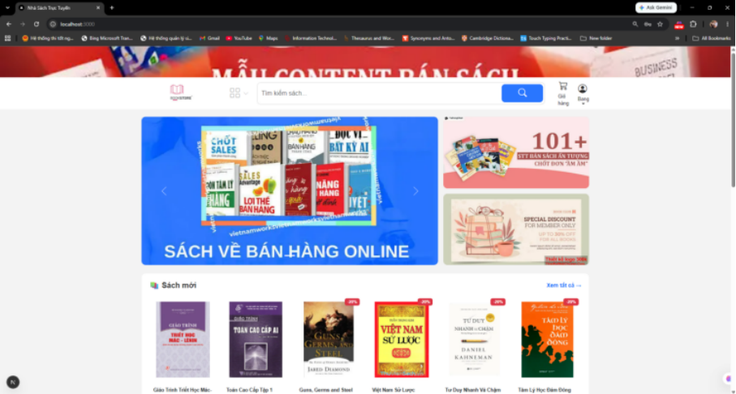
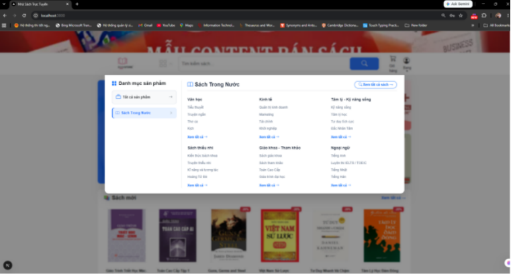
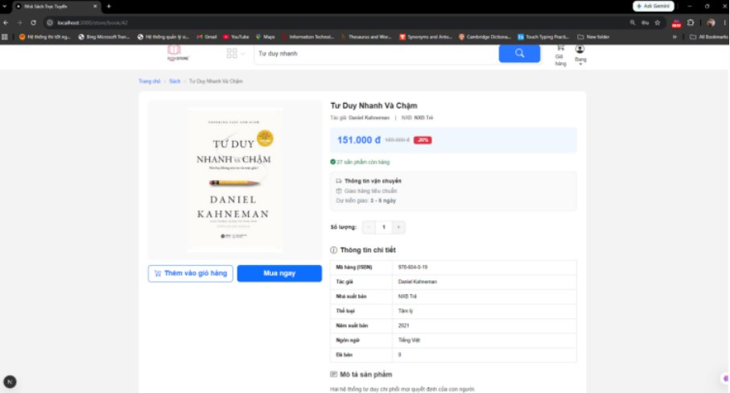
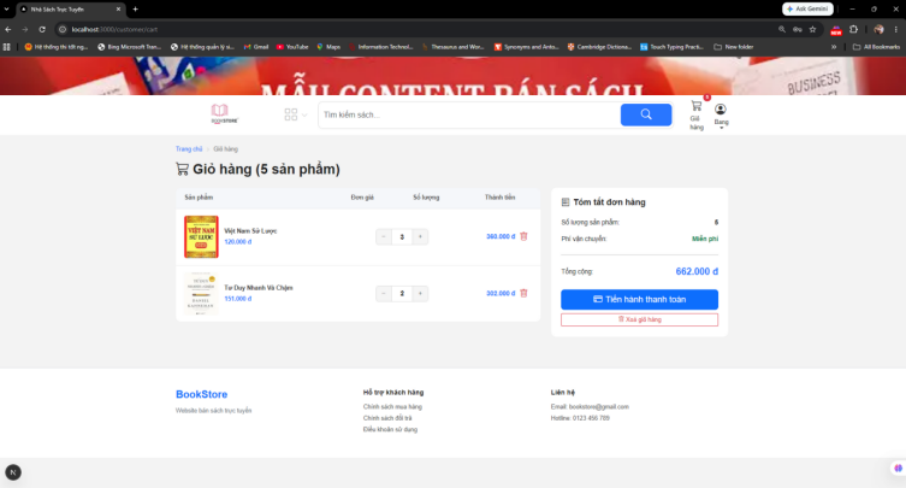
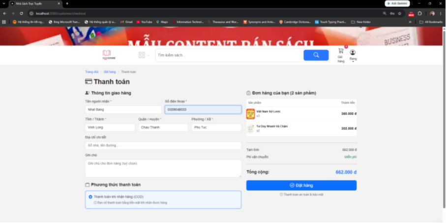
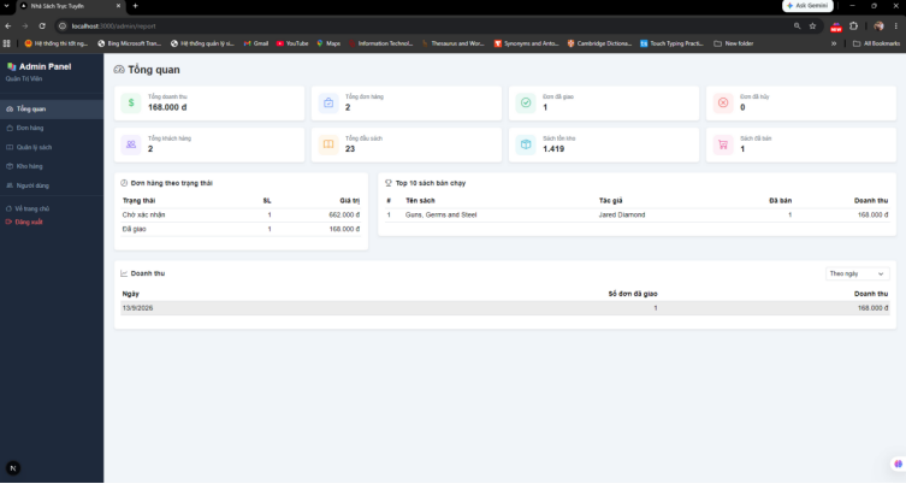

# 📚 Website Bán Sách Trực Tuyến | Online Bookstore Platform

> **Nền tảng thương mại điện tử chuyên biệt cho mua bán và quản lý sách trực tuyến.**  
> *A dedicated full-stack e-commerce platform for online book retail and inventory management.*

---

## 📑 Mục lục / Table of Contents

- [1. Giới thiệu dự án / Project Overview](#1-giới-thiệu-dự-án--project-overview)
- [2. Công nghệ sử dụng / Tech Stack](#2-công-nghệ-sử-dụng--tech-stack)
- [3. Giao diện minh họa / Screenshots & Demo](#3-giao-diện-minh-họa--screenshots--demo)
- [4. Hướng dẫn cài đặt và chạy / Installation & Getting Started](#4-hướng-dẫn-cài-đặt-và-chạy--installation--getting-started)
  - [Yêu cầu môi trường / Prerequisites](#yêu-cầu-môi-trường--prerequisites)
  - [Bước 1: Khởi tạo Cơ sở dữ liệu / Step 1: Database Setup](#bước-1-khởi-tạo-cơ-sở-dữ-liệu--step-1-database-setup)
  - [Bước 2: Cài đặt và cấu hình Backend / Step 2: Backend Setup](#bước-2-cài-đặt-và-cấu-hình-backend--step-2-backend-setup)
  - [Bước 3: Cài đặt và cấu hình Frontend / Step 3: Frontend Setup](#bước-3-cài-đặt-và-cấu-hình-frontend--step-3-frontend-setup)
- [5. Cấu trúc thư mục / Directory Structure](#5-cấu-trúc-thư-mục--directory-structure)
- [6. Chức năng, API và Thông tin bổ sung / Features, API & Additional Info](#6-chức-năng-api-và-thông-tin-bổ-sung--features-api--additional-info)
  - [Chức năng hệ thống / System Features](#chức-năng-hệ-thống--system-features)
  - [Danh sách API chính / Key API Endpoints](#danh-sách-api-chính--key-api-endpoints)
  - [Tài khoản demo / Demo Accounts](#tài-khoản-demo--demo-accounts)
  - [🗺️ Hướng phát triển / Roadmap](#️-hướng-phát-triển--roadmap)
  - [👨‍💻 Tác giả / Author](#-tác-giả--author)
  - [📄 Giấy phép / License](#-giấy-phép--license)

---

## 1. Giới thiệu dự án / Project Overview

### 🇻🇳 Tiếng Việt

- **Tên dự án**: Website Bán Sách Trực Tuyến (`WebBanSachTrucTuyen`).
- **Mục đích**: Cung cấp giải pháp bán lẻ sách toàn diện trên nền tảng web, kết nối độc giả với kho tàng sách đa dạng; đồng thời số hóa quy trình vận hành kho, xử lý đơn hàng và thống kê doanh thu cho cửa hàng sách.
- **Vấn đề giải quyết**:
  - **Quản lý danh mục & tồn kho chặt chẽ**: Giải quyết bài toán thất thoát và sai lệch số lượng tồn thông qua quy trình nhập hàng có kiểm soát (phiếu nhập, chi tiết nhập, tự động tính giá vốn/tồn kho bằng Stored Procedures).
  - **Trải nghiệm mua hàng trực quan**: Hỗ trợ tìm kiếm thông minh theo tựa sách, tác giả, thể loại, nhà xuất bản, mức giá và trạng thái giảm giá.
  - **Minh bạch đơn hàng & chăm sóc tự động**: Tự động gửi email thông báo chi tiết khi đặt hàng thành công hoặc khi đơn bị hủy, giúp nâng cao mức độ hài lòng của khách hàng.
  - **Báo cáo kinh doanh thời gian thực**: Trực quan hóa số liệu doanh thu, các đầu sách bán chạy nhất và tỷ lệ xử lý đơn hàng phục vụ việc ra quyết định.
- **Đối tượng sử dụng**:
  - **Khách hàng (Customer)**: Độc giả có nhu cầu tìm đọc, đặt mua sách, theo dõi tiến độ đơn hàng và xem lại lịch sử giao dịch.
  - **Nhân viên (Staff)**: Phụ trách quản lý nhập hàng vào kho và theo dõi, cập nhật tiến độ xử lý đơn hàng.
  - **Quản trị viên (Admin)**: Chủ cửa hàng hoặc trưởng bộ phận điều hành toàn bộ dữ liệu người dùng, phân quyền, danh mục sách, đơn hàng và báo cáo tài chính.

### 🇬🇧 English

- **Project Name**: Online Bookstore Platform (`WebBanSachTrucTuyen`).
- **Purpose**: Deliver an end-to-end e-commerce solution for bookstores, bridging book lovers with extensive catalogs while streamlining warehouse inventory, order lifecycle, and sales analytics.
- **Problems Solved**:
  - **Strict Inventory & Stock Control**: Eliminates discrepancies via transactional stock replenishment (goods receipt slips, itemized lots, and automated quantity updates via database stored procedures).
  - **Intuitive Browsing Experience**: Empowers users with fast multi-criteria searches (title, author, genre, publisher, price range, and discounts).
  - **Transparent Tracking & Automated Communication**: Dispatches automated email notifications with full itemized summaries upon order placement and cancellation.
  - **Real-Time Business Intelligence**: Delivers quick insights into revenue trends, top-selling titles, and order fulfillment rates.
- **Target Users**:
  - **Customers**: Browse books, manage shopping carts, place orders, and trace delivery history.
  - **Staff**: Manage warehouse stock replenishment slips and update operational order statuses.
  - **Administrators**: Maintain full authority over user accounts, permissions, book catalogs, orders, and business analytics.

---

## 2. Công nghệ sử dụng / Tech Stack

| Tầng / Layer | Công nghệ / Technology | Mô tả / Description |
|---|---|---|
| **Frontend** | **Next.js 16** (App Router) | Framework React hiện đại hỗ trợ Server/Client Components và SEO tối ưu. |
| | **React 19** | Thư viện xây dựng giao diện người dùng reactive. |
| | **React-Bootstrap 5 & Bootstrap 5** | Hệ thống grid và UI components chuẩn hóa, phản hồi tốt trên mobile/desktop. |
| | **Bootstrap Icons** | Bộ icon trực quan cho giao diện thương mại điện tử. |
| | **Tailwind CSS v4** | Tiện ích CSS bổ trợ cho styling linh hoạt. |
| | **TypeScript 5** | Đảm bảo tính an toàn kiểu dữ liệu (Type-safety) toàn diện phía client. |
| **Backend** | **Node.js & Express.js** | Nền tảng runtime và RESTful API engine linh hoạt, hiệu năng cao. |
| | **TypeScript 5** (`ts-node`, `nodemon`) | Ngôn ngữ backend chặt chẽ, hỗ trợ hot-reloading trong môi trường phát triển. |
| | **JSON Web Token (JWT)** | Cơ chế xác thực phi trạng thái (Stateless Auth) và phân quyền vai trò người dùng. |
| | **bcryptjs** | Băm mật khẩu an toàn với thuật toán mã hóa một chiều kèm salt. |
| | **Multer** | Xử lý upload và lưu trữ tệp ảnh bìa sách vào thư mục tĩnh trên server. |
| **Database** | **Microsoft SQL Server** (2019+) | Hệ quản trị cơ sở dữ liệu quan hệ mạnh mẽ, lưu trữ toàn bộ thực thể. |
| | **node-mssql** (`mssql`) | Driver kết nối chính thức giữa Node.js và Microsoft SQL Server. |
| | **Stored Procedures & Triggers** | Toàn bộ logic giao tác phức tạp, kiểm tra ràng buộc tồn kho được thực thi ở tầng DB. |
| **Dịch vụ ngoài** | **Nodemailer (Gmail SMTP)** | Tự động hóa gửi email biên lai xác nhận đơn hàng và thông báo hủy đơn. |

---

## 3. Giao diện minh họa / Screenshots & Demo

> **Lưu ý / Note**: Tất cả hình ảnh chụp màn hình được lưu trong thư mục `docs/images/` với đường dẫn tương đối. Vui lòng chụp các màn hình tương ứng và lưu đúng tên file bên dưới.  
> *All screenshots are referenced relatively from `docs/images/`. Place your actual captured files inside `docs/images/` with the designated filenames below.*

| STT | Trang / Screen | Ảnh minh họa / Preview | Mô tả / Description |
|:---:|---|---|---|
| 01 | **Trang chủ**<br>*Home Page* |  | Banner khuyến mãi, danh sách sách mới, sách bán chạy và sách đang giảm giá. |
| 02 | **Tìm kiếm & Lọc**<br>*Search & Filter* |  | Bộ lọc kết hợp theo thể loại, tác giả, nhà xuất bản, khoảng giá và sắp xếp. |
| 03 | **Chi tiết sách**<br>*Book Detail* |  | Thông tin xuất bản, tình trạng tồn kho, mô tả chi tiết và nút thêm vào giỏ. |
| 04 | **Giỏ hàng**<br>*Shopping Cart* |  | Điều chỉnh số lượng, tính tổng tiền tự động và kiểm tra lượng tồn trước khi đặt. |
| 05 | **Thanh toán đặt hàng**<br>*Checkout* |  | Nhập thông tin giao nhận hàng, địa chỉ ba cấp (Tỉnh/Huyện/Xã) và ghi chú. |
| 06 | **Lịch sử đơn hàng**<br>*Order Tracking* |  | Khách hàng theo dõi trạng thái đơn hàng (Chờ xác nhận, Đang giao, Đã giao, Đã hủy). |
| 07 | **Báo cáo & Tổng quan**<br>*Admin Dashboard* |  | Biểu đồ doanh thu, tổng số đơn hàng, số sách đã bán và top sách bán chạy nhất. |
| 08 | **Quản lý sách**<br>*Book Catalog* |  | Thêm mới, chỉnh sửa thông tin sách, cập nhật ảnh bìa và bật/tắt trạng thái hiển thị. |
| 09 | **Quản lý nhập hàng**<br>*Inventory Import* |  | Tạo phiếu nhập kho theo nhà cung cấp, cập nhật giá nhập và số lượng tồn tự động. |
| 10 | **Xử lý đơn hàng**<br>*Order Processing* |  | Nhân viên/Admin duyệt đơn, chuyển trạng thái giao hàng và xử lý hủy đơn kèm lý do. |
| 11 | **Email xác nhận đơn**<br>*Email Notifications* |  | Email tự động gửi tới hộp thư khách hàng với đầy đủ chi tiết đơn và tổng tiền. |

---

## 4. Hướng dẫn cài đặt và chạy / Installation & Getting Started

### Yêu cầu môi trường / Prerequisites

Trước khi bắt đầu, hãy đảm bảo máy tính của bạn đã cài đặt các phần mềm sau:
- **Node.js**: Phiên bản `>= 18.x` (khuyến nghị `20.x` LTS trở lên).
- **npm**: Phiên bản `>= 9.x` (đi kèm sẵn khi cài Node.js).
- **Microsoft SQL Server**: Phiên bản `2019` hoặc mới hơn.
- **SQL Server Management Studio (SSMS)**: Hoặc công cụ quản lý SQL tương đương (DBeaver, Azure Data Studio).
- **Tài khoản Gmail**: Bật xác minh 2 bước để tạo **Mật khẩu ứng dụng (App Password)** cho tính năng gửi mail.

---

### Bước 1: Khởi tạo Cơ sở dữ liệu / Step 1: Database Setup

1. Mở **SQL Server Management Studio (SSMS)** và đăng nhập vào SQL Server instance của bạn.
2. Mở tệp script: `Database/DBWebBanSach.sql`.
3. Nhấn **Execute (F5)** để thực thi script.
4. Quá trình này sẽ tự động:
   - Tạo cơ sở dữ liệu `WebBanSach`.
   - Tạo các bảng: `vai_tro`, `nguoi_dung`, `the_loai_sach`, `nha_xuat_ban`, `sach`, `gio_hang`, `chi_tiet_gio_hang`, `don_hang`, `chi_tiet_don_hang`, `phieu_nhap`, `chi_tiet_phieu_nhap`.
   - Tạo các **Stored Procedures** nghiệp vụ, triggers và indexes tối ưu hóa truy vấn.

---

### Bước 2: Cài đặt và cấu hình Backend / Step 2: Backend Setup

1. Mở terminal và di chuyển vào thư mục `backend`:
   ```bash
   cd backend
   ```

2. Cài đặt các gói thư viện phụ thuộc:
   ```bash
   npm install
   ```

3. Tạo tệp cấu hình môi trường `.env`:
   - Trên Windows PowerShell:
     ```powershell
     Copy-Item .env.example .env
     ```
   - Trên Linux / macOS / Bash:
     ```bash
     cp .env.example .env
     ```

4. Cập nhật các biến trong `.env` phù hợp với máy của bạn:
   ```env
   # === CẤU HÌNH SERVER ===
   PORT=5000

   # === KẾT NỐI SQL SERVER ===
   DB_SERVER=localhost
   DB_PORT=1433
   DB_NAME=WebBanSach
   DB_USER=sa
   DB_PASSWORD=YourPassword123

   # === BẢO MẬT JWT ===
   JWT_SECRET=your_super_secret_jwt_key_here_change_it
   JWT_EXPIRES_IN=7d

   # === DỊCH VỤ EMAIL (NODEMAILER - GMAIL) ===
   MAIL_HOST=smtp.gmail.com
   MAIL_PORT=587
   MAIL_USER=your_email@gmail.com
   MAIL_PASS=your_16_digit_app_password
   MAIL_FROM="Nhà Sách Trực Tuyến <your_email@gmail.com>"
   ```

   > **💡 Mẹo cấu hình SQL & Gmail**:
   > - **SQL Server**: Nếu dùng tài khoản xác thực Windows (Windows Authentication), bạn có thể để trống hoặc xóa dòng `DB_USER` và `DB_PASSWORD`. Hệ thống sẽ tự động chuyển sang chế độ `trustedConnection: true`.
   > - **Gmail App Password**: Truy cập [Google Account Security](https://myaccount.google.com/security) → Bật **2-Step Verification** → Vào mục **App Passwords** → Tạo mật khẩu ứng dụng mới (16 ký tự) và điền vào `MAIL_PASS`.

5. Khởi tạo dữ liệu mẫu (Seeder):
   ```bash
   npm run seed
   ```
   *Lệnh này sẽ tự động nạp vai trò, tài khoản mẫu (Admin & Nhân viên), 10 thể loại sách, 6 nhà xuất bản và hơn 20 tựa sách kinh điển kèm ảnh bìa.*

6. Chạy máy chủ Backend:
   ```bash
   npm run dev
   ```
   *Backend khởi động thành công sẽ hiển thị:*
   ```text
   Kết nối SQL Server thành công!
   Server đang chạy tại: http://localhost:5000
   API endpoint:  http://localhost:5000/api
   Static files:  http://localhost:5000/uploads
   ```

---

### Bước 3: Cài đặt và cấu hình Frontend / Step 3: Frontend Setup

1. Mở một cửa sổ terminal mới và di chuyển vào thư mục frontend:
   ```bash
   cd web-ban-sach-truc-tuyen
   ```

2. Cài đặt các gói thư viện phụ thuộc:
   ```bash
   npm install
   ```

3. Kiểm tra hoặc tạo file `.env.local` từ mẫu:
   ```bash
   # Nếu chưa có file .env.local, tạo từ .env.local.example:
   # Windows PowerShell:
   Copy-Item .env.local.example .env.local
   # Linux/macOS:
   cp .env.local.example .env.local
   ```

   Nội dung file `.env.local`:
   ```env
   NEXT_PUBLIC_API_URL=http://localhost:5000/api
   ```

4. Khởi chạy ứng dụng Frontend:
   ```bash
   npm run dev
   ```

5. Mở trình duyệt và truy cập: **[http://localhost:3000](http://localhost:3000)**.

---

## 5. Cấu trúc thư mục / Directory Structure

```text
WebBanSachTrucTuyen/
├── Database/
│   └── DBWebBanSach.sql              # Script DDL/DML, Stored Procedures, Triggers & Index
├── backend/                          # Backend REST API (Node.js + Express + TypeScript)
│   ├── config/                       # Cấu hình Database kết nối SQL Server & Nodemailer
│   │   ├── database.ts
│   │   └── mail.config.ts
│   ├── controllers/                  # Tầng xử lý logic request/response
│   │   ├── auth.controller.ts
│   │   ├── book.controller.ts
│   │   ├── cart.controller.ts
│   │   ├── dashboard.controller.ts
│   │   ├── nhaphang.controller.ts
│   │   ├── order.controller.ts
│   │   └── user.controller.ts
│   ├── middleware/                   # Middlewares: Xác thực JWT, phân quyền, upload ảnh, bắt lỗi
│   │   ├── authMiddleware.ts
│   │   ├── roleMiddleware.ts
│   │   ├── uploadMiddleware.ts
│   │   └── errorHandler.ts
│   ├── models/                       # Type definitions & Interfaces cho các thực thể
│   ├── routes/                       # Khai báo tuyến đường API (Routes)
│   │   ├── index.ts                  # Bộ gom trung tâm tất cả các route
│   │   ├── auth.routes.ts
│   │   ├── book.routes.ts
│   │   ├── cart.routes.ts
│   │   ├── dashboard.routes.ts
│   │   ├── nhaphang.routes.ts
│   │   ├── order.routes.ts
│   │   └── user.routes.ts
│   ├── services/                     # Tầng giao tiếp cơ sở dữ liệu qua Stored Procedures
│   ├── seeder/                       # Script nạp dữ liệu sách mẫu và tài khoản quản trị
│   │   └── seed.ts
│   ├── views/                        # Template HTML gửi email thông báo đơn hàng
│   ├── public/uploads/               # Thư mục lưu trữ hình ảnh tải lên (ảnh bìa sách)
│   ├── .env.example                  # Mẫu biến môi trường backend
│   ├── package.json
│   ├── tsconfig.json
│   └── server.ts                     # File điểm khởi đầu (Entrypoint) của backend server
├── web-ban-sach-truc-tuyen/          # Frontend Web Application (Next.js 16 + React 19)
│   ├── app/                          # Cấu trúc App Router của Next.js
│   │   ├── admin/                    # Các trang dành riêng cho Quản trị viên (Admin)
│   │   │   ├── book/                 # Quản lý danh mục sách
│   │   │   ├── inventory/            # Quản lý nhập hàng kho
│   │   │   ├── order/                # Quản lý đơn đặt hàng
│   │   │   ├── report/               # Báo cáo doanh thu & thống kê
│   │   │   └── user/                 # Quản lý tài khoản người dùng/nhân viên
│   │   ├── auth/                     # Tuyến đường đăng nhập / đăng ký tài khoản
│   │   │   ├── login/
│   │   │   └── register/
│   │   ├── customer/                 # Tuyến đường dành cho khách hàng cá nhân
│   │   │   ├── account/              # Hồ sơ cá nhân & đổi mật khẩu
│   │   │   ├── cart/                 # Xem & cập nhật giỏ hàng
│   │   │   └── checkout/             # Đặt hàng và thanh toán
│   │   ├── staff/                    # Tuyến đường phân quyền dành cho Nhân viên kho/vận đơn
│   │   │   ├── inventory/            # Tạo và quản lý phiếu nhập hàng
│   │   │   └── order/                # Xem và cập nhật trạng thái đơn hàng
│   │   ├── store/                    # Tuyến đường duyệt sách cửa hàng
│   │   │   ├── book/[id]/            # Xem thông tin chi tiết một đầu sách
│   │   │   └── search/               # Tìm kiếm và phân trang sách
│   │   ├── layout.tsx                # Layout bao ngoài gốc
│   │   └── page.tsx                  # Trang chủ (Landing Page)
│   ├── components/                   # Các component giao diện dùng chung (Header, Footer, Banner...)
│   ├── contexts/                     # React Context (AuthContext quản lý phiên đăng nhập)
│   ├── lib/                          # Các hàm gọi API tương tác với Backend
│   ├── types/                        # Định nghĩa TypeScript data models phía frontend
│   ├── .env.local.example            # Mẫu biến môi trường frontend
│   ├── package.json
│   └── next.config.ts
├── docs/                             # Tài liệu bổ sung & Hình ảnh minh họa
│   └── images/                       # Thư mục chứa ảnh chụp màn hình giao diện
└── README.md                         # Tài liệu hướng dẫn dự án (File này)
```

---

## 6. Chức năng, API và Thông tin bổ sung / Features, API & Additional Info

### Chức năng hệ thống / System Features

#### 1. Khách hàng (Customer)
- **Duyệt sách**: Xem sách mới ra mắt, sách bán chạy nhất, sách đang có giá khuyến mãi.
- **Tìm kiếm nâng cao**: Tra cứu theo từ khóa tiêu đề, tên tác giả, lọc đa chiều theo thể loại, nhà xuất bản, sắp xếp theo giá tăng/giảm dần hoặc mức độ phổ biến.
- **Xem chi tiết sách**: Nắm rõ thông tin ISBN, năm phát hành, số lượng tồn kho thực tế, tóm tắt nội dung.
- **Giỏ hàng & Đặt hàng**: Thêm sách vào giỏ, cập nhật số lượng trực quan, tiến hành đặt hàng với thông tin địa chỉ 3 cấp (Tỉnh/Thành, Quận/Huyện, Phường/Xã).
- **Theo dõi đơn hàng**: Xem chi tiết trạng thái từng đơn hàng (Chờ duyệt, Đang vận chuyển, Đã giao, Đã hủy) và gửi yêu cầu hủy đơn khi đơn chưa vận chuyển.
- **Thông báo qua Email**: Nhận email xác nhận đơn kèm mã đơn hàng và danh sách sản phẩm ngay sau khi hoàn tất đặt hàng.

#### 2. Nhân viên kho & vận hành (Staff)
- **Quản lý nhập hàng**: Tạo phiếu nhập kho, chọn nhà cung cấp, nhập số lượng sách và đơn giá nhập; số lượng sách trong kho tự động được cộng dồn theo giao tác an toàn.
- **Xử lý đơn hàng**: Xem danh sách các đơn hàng mới, cập nhật trạng thái đơn qua từng giai đoạn và hủy đơn theo quy định.

#### 3. Quản trị viên (Admin)
- **Toàn quyền Quản lý sách**: Tạo mới đầu sách kèm chức năng tải ảnh bìa trực tiếp, cập nhật giá bán, sửa thông tin xuất bản hoặc tạm dừng hiển thị sách.
- **Quản lý tài khoản**: Xem danh sách toàn bộ người dùng, tạo tài khoản cho nhân viên mới, khóa/mở khóa tài khoản người dùng vi phạm.
- **Báo cáo & Phân tích (Dashboard)**: Theo dõi tổng doanh thu theo khoảng thời gian, tổng số đơn hàng đã hoàn tất, thống kê sách bán chạy nhất và tỷ lệ giao hàng thành công.

---

### Danh sách API chính / Key API Endpoints

Mọi endpoint đều được định tuyến qua tiền tố: `http://localhost:5000/api`

| Nhóm / Group | Phương thức / Method | Tuyến đường / Endpoint | Quyền / Access | Mô tả / Description |
|---|:---:|---|:---:|---|
| **Xác thực**<br>*(Auth)* | `POST` | `/api/auth/register` | Public | Đăng ký tài khoản khách hàng mới |
| | `POST` | `/api/auth/login` | Public | Đăng nhập hệ thống, nhận JWT Token |
| | `GET` | `/api/auth/me` | Authenticated | Lấy thông tin tài khoản đang đăng nhập |
| | `POST` | `/api/auth/change-password` | Authenticated | Đổi mật khẩu tài khoản hiện tại |
| **Sách & Danh mục**<br>*(Catalog)* | `GET` | `/api/books` | Public | Tìm kiếm, lọc và phân trang danh sách sách |
| | `GET` | `/api/books/:id` | Public | Lấy thông tin chi tiết một cuốn sách theo ID |
| | `GET` | `/api/categories` | Public | Danh sách tất cả các thể loại sách |
| | `GET` | `/api/publishers` | Public | Danh sách tất cả các nhà xuất bản |
| | `POST` | `/api/books` | `QUAN_TRI_VIEN` | Tạo đầu sách mới kèm tải ảnh bìa |
| | `PUT` | `/api/books/:id` | `QUAN_TRI_VIEN` | Cập nhật thông tin chi tiết sách |
| | `PATCH` | `/api/books/:id/status` | `QUAN_TRI_VIEN` | Bật hoặc tắt trạng thái kinh doanh sách |
| **Giỏ hàng**<br>*(Cart)* | `GET` | `/api/cart` | `KHACH_HANG` | Xem giỏ hàng hiện tại của khách hàng |
| | `POST` | `/api/cart` | `KHACH_HANG` | Thêm sách vào giỏ hàng |
| | `PUT` | `/api/cart/:idSach` | `KHACH_HANG` | Cập nhật số lượng của một cuốn sách trong giỏ |
| | `DELETE` | `/api/cart/:idSach` | `KHACH_HANG` | Xóa một mục sách khỏi giỏ hàng |
| | `DELETE` | `/api/cart` | `KHACH_HANG` | Xóa sạch toàn bộ sản phẩm trong giỏ |
| **Đơn hàng**<br>*(Order)* | `POST` | `/api/orders` | `KHACH_HANG` | Tạo đơn hàng mới từ giỏ hàng (tự động gửi email) |
| | `GET` | `/api/orders` | Authenticated | Lấy danh sách đơn (khách xem của mình, staff/admin xem tất cả) |
| | `GET` | `/api/orders/:maDon` | Authenticated | Xem chi tiết sản phẩm và lịch sử của mã đơn |
| | `PATCH` | `/api/orders/:maDon/status` | `NHAN_VIEN`, `QUAN_TRI_VIEN` | Chuyển đổi trạng thái đơn hàng |
| | `PATCH` | `/api/orders/:maDon/cancel` | Authenticated | Hủy đơn hàng và tự động hoàn trả số lượng vào kho |
| **Nhập hàng**<br>*(Inventory)* | `POST` | `/api/nhaphang` | `NHAN_VIEN`, `QUAN_TRI_VIEN` | Lập phiếu nhập sách mới vào kho |
| | `GET` | `/api/nhaphang` | `NHAN_VIEN`, `QUAN_TRI_VIEN` | Xem lịch sử các phiếu nhập hàng |
| **Báo cáo**<br>*(Dashboard)* | `GET` | `/api/dashboard/overview` | `QUAN_TRI_VIEN` | Số liệu tổng hợp (Doanh thu, số đơn, sách đã bán) |
| | `GET` | `/api/dashboard/revenue` | `QUAN_TRI_VIEN` | Báo cáo doanh thu theo mốc thời gian |
| | `GET` | `/api/dashboard/top-books` | `QUAN_TRI_VIEN` | Thống kê danh sách sách bán chạy nhất |
| | `GET` | `/api/dashboard/order-stats`| `QUAN_TRI_VIEN` | Tỷ lệ phân bổ trạng thái các đơn hàng |
| **Người dùng**<br>*(User)* | `PUT` | `/api/users/me` | Authenticated | Cập nhật hồ sơ cá nhân |
| | `GET` | `/api/users` | `QUAN_TRI_VIEN` | Xem danh sách tất cả người dùng trong hệ thống |
| | `POST` | `/api/users` | `QUAN_TRI_VIEN` | Tạo tài khoản nhân viên hoặc quản trị mới |
| | `PATCH` | `/api/users/:id/status` | `QUAN_TRI_VIEN` | Khóa hoặc mở khóa tài khoản |

---

### Tài khoản demo / Demo Accounts

Sau khi chạy lệnh `npm run seed` ở thư mục `backend`, hệ thống được khởi tạo sẵn các tài khoản sau:

| Vai trò / Role | Email | Mật khẩu / Password | Quyền hạn / Permissions |
|---|---|---|---|
| **Quản trị viên** *(Admin)* | `admin@bookstore.com` | `Admin@123` | Toàn quyền quản trị hệ thống, quản lý sách, xem dashboard doanh thu, quản lý tài khoản. |
| **Nhân viên** *(Staff)* | `nhanvien@bookstore.com` | `Staff@123` | Lập phiếu nhập kho, theo dõi và cập nhật trạng thái đơn hàng. |
| **Khách hàng** *(Customer)* | *Tự đăng ký mới* | *Tự thiết lập* | Đăng ký trực tiếp tại trang `/auth/register` để trải nghiệm mua sắm, giỏ hàng và nhận email đơn hàng thật. |

---

### 🗺️ Hướng phát triển / Roadmap

- [ ] **Cổng thanh toán trực tuyến**: Tích hợp thanh toán qua VNPAY, MoMo, ZaloPay và thẻ tín dụng quốc tế (Stripe).
- [ ] **Đánh giá & Bình luận**: Cho phép khách hàng đã mua sản phẩm để lại phản hồi sao và bình luận nhận xét cuốn sách.
- [ ] **Tối ưu hiệu năng**: Triển khai bộ nhớ đệm (Caching) bằng Redis cho danh mục sách và phân trang.
- [ ] **Hoàn thiện kiểm thử**: Xây dựng bộ kiểm thử tự động (Unit Test & Integration Test) sử dụng Jest và Supertest.
- [ ] **Container hóa**: Đóng gói toàn bộ ứng dụng và SQL Server với Docker & Docker Compose để triển khai bằng 1 lệnh.
- [ ] **Triển khai Production**: Thiết lập CI/CD tự động hóa trên GitHub Actions và deploy lên đám mây (Vercel cho frontend, Render/Railway/VPS cho backend).

---

### 👨‍💻 Tác giả / Author

- **Họ và tên / Full Name**: [Tên của bạn]
- **GitHub**: [https://github.com/bangnn106](https://github.com/bangnn106) *(hoặc URL profile của bạn)*
- **Email**: [nhatbang1006.179@gmail.com](mailto:nhatbang1006.179@gmail.com)

---

### 📄 Giấy phép / License

Dự án này được phân phối dưới giấy phép **MIT License**. Bạn có toàn quyền sử dụng, sửa đổi và phân phối mã nguồn này cho mục đích học tập hoặc thương mại.
